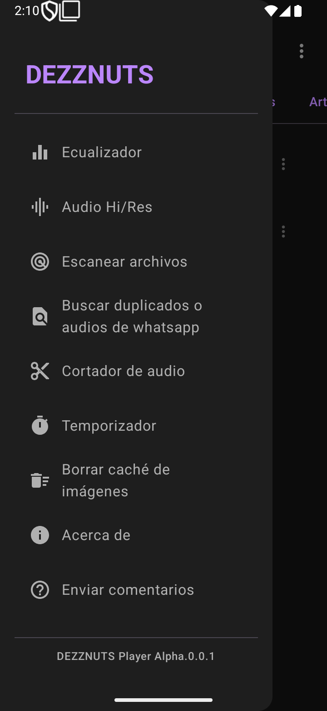

<div align="center">


# DEZZNUTS 🎧

**A free, open-source local music player for Android.**

[🇪🇸 Español](README.md) · [🇬🇧 English](README.en.md)


</div>

Features other players lock behind a paywall (auto-tagging, audio cutter, equalizer, sleep timer…), offered freely, "just for the love of it".

> ⚠️ **Status: early alpha (`0.0.1`).** The core player works and the project builds (unit tests + CI). Some menu entries are UI only, with no logic yet; see [Known issues](#-known-issues).

## 📸 Screenshots

<div align="center">




</div>

## 📦 What is it?

A native Android app written in **Kotlin + Jetpack Compose** that scans the music stored on the device (MediaStore) and plays it in the background with **Media3 / ExoPlayer**. It organizes by album, artist and genre, and supports playlists, favorites, search, ID3 tag editing and automatic cover art (public Deezer and iTunes APIs, no API keys).

## ✨ Features

| Area | Detail |
|------|--------|
| **Local scan** | Reads device music via `MediaStore`, in chunks of 100 so the UI never blocks. |
| **Background playback** | `MusicService` (Media3 `MediaSessionService`) with notification controls. |
| **Full-screen player** | Swipeable cover carousel, seek bar, previous/next, play/pause, mini-player. |
| **Repeat & shuffle** | `OFF` → `ALL` → `ONE` → `STOP_AFTER_CURRENT`; real shuffle. |
| **Queue** | Reorder by dragging, remove songs. |
| **Library** | Songs, Albums, Artists, Genres, Folders, Playlists, quick lists (recent, most played, favorites). |
| **Search** | With history; album and artist results are navigable. |
| **ID3 tags** | Edit title, artist, album and cover (**jaudiotagger**); "Auto-web" lookup via iTunes. |
| **Artist photos** | From the Deezer API, cached locally. |
| **Hi/Res audio** | Optional 32-bit float output and audio offload (both off by default). |
| **Material 3 dark theme** | Custom palette. |

**🟡 Partial:** the ⋮ song/playlist menus and "Restore playlist" are UI only.
**🔴 Planned:** Equalizer, manual rescan, duplicate finder, audio cutter, sleep timer, About, Send feedback.

For deep details (Hi/Res audio, seek latency, architecture) see [`README.md`](README.md) and [`RESUMEN_PROYECTO.md`](RESUMEN_PROYECTO.md) (Spanish).

## 🧱 Tech stack

Kotlin `2.2.10` · Jetpack Compose (BOM `2026.02.01`) + Material 3 · AndroidX Media3 `1.4.1` · Coil `2.7.0` · jaudiotagger `3.0.1` · AGP `9.4.1` / Gradle `9.8.1` · `minSdk` 24 / `targetSdk` 37 · `SharedPreferences` · JUnit 4 (24 tests) + GitHub Actions.

## 🔧 Build

Requires a recent Android Studio (or JDK 17+) and Android SDK API 37.

```bash
./gradlew assembleDebug        # debug APK in app/build/outputs/apk/debug/
./gradlew installDebug         # install on a connected device/emulator
./gradlew testDebugUnitTest    # unit tests
```

## 🔐 Permissions

| Permission | Why |
|-----------|-----|
| `READ_MEDIA_AUDIO` / `READ_EXTERNAL_STORAGE` | Scan local music |
| `INTERNET` | Artist photos (Deezer) and metadata (iTunes) |
| `FOREGROUND_SERVICE` + `…_MEDIA_PLAYBACK` | Background playback |
| `POST_NOTIFICATIONS` | Player notification |

## 🐞 Known issues

- ⋮ menus and "Restore playlist" have no logic yet.
- Persistence still uses `SharedPreferences` (Room/DataStore migration pending).
- Genre is only read on Android 11+.
- Tag editing may fail on some devices due to scoped-storage restrictions.

## 🗺️ Roadmap

1. Manual rescan · 2. Equalizer & sleep timer · 3. Audio cutter & duplicate finder · 4. Finish ⋮ menus · 5. Migrate to Room/DataStore.

## 🤝 Contributing

Contributions of any size are welcome. Please read [CONTRIBUTING.md](CONTRIBUTING.md) and the [Code of Conduct](CODE_OF_CONDUCT.md).

## 📜 License

Distributed under **GPL-3.0**; see [`LICENSE`](LICENSE).
