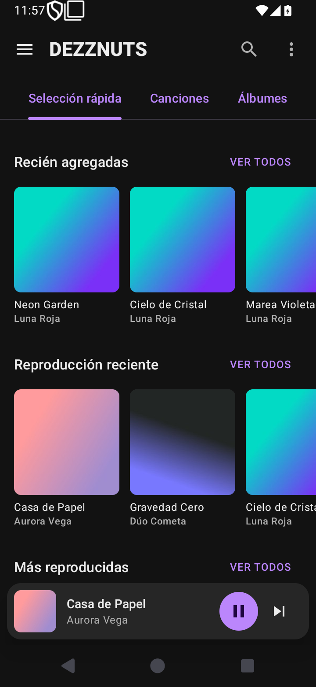
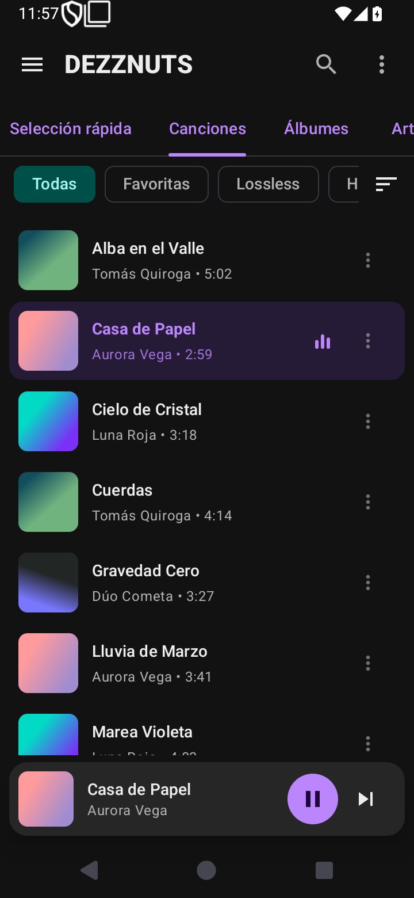
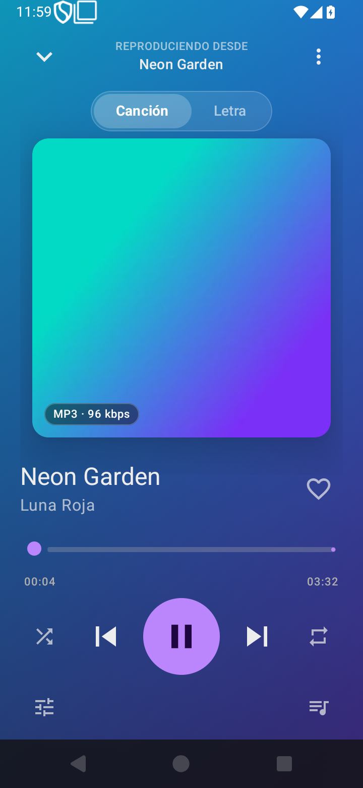
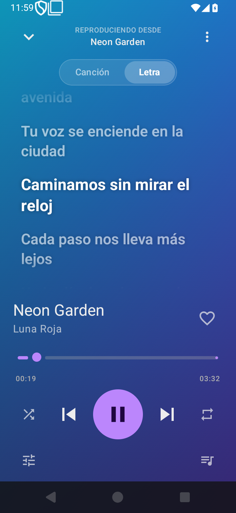
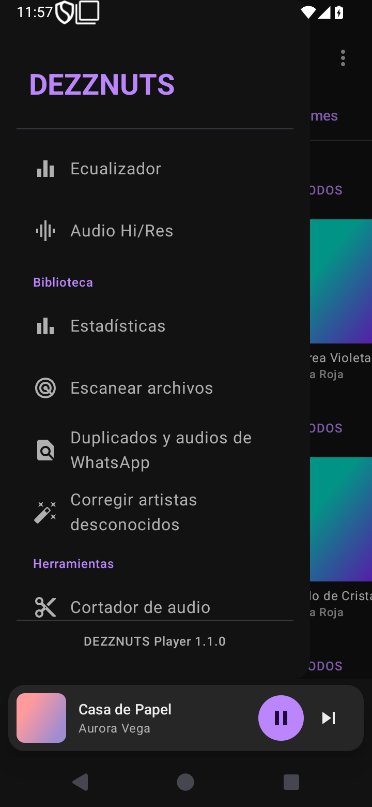
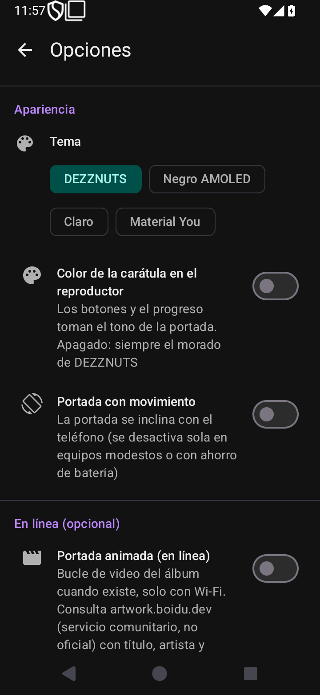

<div align="center">


# DEZZNUTS 🎧

**Reproductor de música local, libre y gratuito para Android.**

[🇪🇸 Español](README.md) · [🇬🇧 English](README.en.md)


</div>

Reproductor de música **local** para Android, open source y gratuito. La idea es ofrecer libremente
funciones que otros reproductores suelen cobrar (etiquetado automático, cortador de audio,
ecualizador, temporizador), "solo por amor al arte".

> ⚠️ **Estado: alfa temprana.** El reproductor base ya funciona y el proyecto compila (con pruebas
> unitarias y CI). Algunas entradas del menú todavía son solo interfaz; ver
> [Problemas conocidos](#-problemas-conocidos).

App nativa en **Kotlin + Jetpack Compose** que escanea la música del dispositivo (MediaStore) y la
reproduce en segundo plano con **Media3 / ExoPlayer**.

## 📸 Capturas

<div align="center">






</div>

---

---

## ✨ Funcionalidades

**Interfaz**

- Barra superior con ☰ · lupa · ⋮, **pestañas deslizables** (Selección rápida, Canciones, Álbumes, Artistas, Géneros,
  Listas, Carpetas y **YT Music**) y menú lateral; los detalles se apilan y "atrás" vuelve a la pantalla anterior.
- Identidad DEZZNUTS: **morado** `#BB86FC` y turquesa sobre negro; temas opcionales (AMOLED, claro, Material You).
- Pantalla de **Opciones** completa; textos en **español e inglés**.
- Reproductor a pantalla completa: portada, título y favorito, progreso, controles, pestaña de **letras**
  sincronizadas (LRCLIB) y fondo animado con la carátula. Se abre deslizando el mini-reproductor hacia arriba y
  se cierra arrastrando hacia abajo; deslizar el mini-reproductor a los lados cambia de canción.
- Pantallas de permiso, carga y biblioteca vacía con la bellota de la marca.
- Ahorro automático en equipos modestos: sin animaciones en 2 núcleos, poca RAM o ahorro de batería
  (ver [`docs/OPTIMIZACION.md`](docs/OPTIMIZACION.md)).

**Biblioteca**

- Escaneo local vía `MediaStore` y escaneo manual de carpetas (filtra audios cortos y archivos ocultos).
- Canciones (filtros Todas / Favoritas / Lossless / Hi-Res y **orden** por título, artista, álbum, duración o
  recién agregadas), Álbumes, Artistas, Listas, Géneros y Carpetas.
- Inicio: recién agregadas, reproducción reciente, más reproducidas, favoritos y *moods*.
- Búsqueda con historial; los álbumes y artistas encontrados abren su ficha.
- Listas de reproducción con portada, restauración de listas borradas e **importar/exportar M3U**.
- **Copia de seguridad** de favoritas, reproducciones y listas (por ruta: sobrevive a reinstalar o cambiar de
  teléfono).

**Reproducción**

- Servicio en segundo plano (`MediaSessionService`) con notificación, favorito y cerrar.
- Repetición `OFF → ALL → ONE → STOP_AFTER_CURRENT`, aleatorio real y cola reordenable.
- Menú ⋮ de canción: **reproducir a continuación**, agregar a la cola o a una lista, ir al álbum/artista,
  editar etiquetas, ficha técnica, cortador de audio y eliminar.
- Ecualizador paramétrico con presets y perfiles por salida, ReplayGain, fundidos y temporizador.

**Herramientas**

- Edición de etiquetas (título, artista, álbum, carátula) con **jaudiotagger** y corrección en lote de
  "artista desconocido".
- Cortador de audio, buscador de duplicados y audios de WhatsApp.
- Carátulas desde la **API de iTunes** y fotos de artista desde **Deezer**, cacheadas en disco.

---

## 🎚️ Audio Hi/Res

Los FLAC, ALAC, WAV y cualquier formato sin pérdida se reproducen **tal cual**: decodifica el códec
del sistema, sin transcodificar ni aplicar DSP. Lo que se puede elegir es **cómo llega esa señal al
DAC**. Menú lateral → **Audio Hi/Res**; los dos ajustes van **apagados por defecto** y se aplican
**en caliente** (el servicio reconstruye el reproductor conservando la cola y la posición).

| Ajuste | Qué hace | Riesgo |
|--------|----------|--------|
| **Salida en 32 bits (float)** | Pasa el PCM de 24/32 bits a punto flotante antes del mezclador, evitando truncarlo a 16 bits. En material de 16 bits no cambia nada. | Si el dispositivo no soporta la salida float, los archivos de 24/32 bits podrían no sonar. |
| **Audio offload** | Envía el archivo comprimido directamente al DSP, sin remuestreo ni mezcla: conserva la frecuencia y la profundidad originales. Requiere Android 10+. | Depende del chip: algunos lo soportan mal (cortes o silencios). Con él activo no se aplican efectos y el float no interviene. |

Los dos cambian la ruta de salida y dependen del dispositivo, así que la decisión es del usuario: se
activan desde el propio diálogo, que explica qué hace cada uno y su riesgo.

Datos que conviene tener claros:

- **El remuestreo del sistema es el límite real**: AudioFlinger lleva todo a la frecuencia nativa de
  salida (normalmente **48000 Hz**), así que un FLAC de CD (44100 Hz) se remuestrea salvo con el
  offload activo o con un DAC USB que negocie la tasa.
- **El truncado a 16 bits sí degrada**: sin la opción float, el material de 24/32 bits pasa por
  `ToInt16PcmAudioProcessor`, que descarta los bits bajos sin dithering.
- **Un FLAC no gana fidelidad con "más kbps"**: es sin pérdida; no hay más información que extraer.
- El diálogo muestra la **frecuencia nativa del dispositivo**.

### Latencia al mover el tiempo (*seek*)

`MusicService.buildLoadControl()` ajusta los valores de ExoPlayer, pensados para streaming, a
reproducción local:

| Ajuste | Por defecto | DEZZNUTS |
|--------|-------------|----------|
| `backBufferDurationMs` | `0` | `30 s` |
| `bufferForPlaybackMs` | `2500` | `1000` |
| `bufferForPlaybackAfterRebufferMs` | `5000` | `2000` |

Los archivos se entregan por **ruta directa** (`file://`) cuando son legibles, en lugar del
`content://` de MediaStore.

El *seek* en FLAC tarda más que en MP3 por el **índice del propio archivo**, algo que la app no puede
cambiar: `FlacSeekTableSeekMap` devuelve las entradas del bloque `SEEKTABLE` tal cual y ExoPlayer
empieza a leer en la entrada **anterior** al punto pedido, descartando todo el audio intermedio. La
tabla que escribe `flac` por defecto tiene un punto cada **10 s**, así que cada salto lee y tira hasta
10 s de audio (~2,4 MB). MP3 no lo sufre porque su índice es mucho más fino.

Se corrige **en el archivo**, sin recodificar y sin pérdida de audio:

```bash
metaflac --list "cancion.flac" | grep -i seektable   # ¿trae tabla y cada cuánto?
metaflac --add-seekpoint=1s "cancion.flac"           # tabla densa (1 punto por segundo)

# Toda la biblioteca de una vez:
find /ruta/a/musica -name '*.flac' -print0 | xargs -0 metaflac --add-seekpoint=1s
```

Verificado: el **MD5 del audio no cambia** y el archivo ocupa lo mismo (se consume el `PADDING`).

Para comprobarlo en el dispositivo, `PlaybackDiagnostics` imprime en logcat lo que tarda cada fase:

```bash
adb logcat -s DezzSeek
```

---

## 🧱 Stack tecnológico

| Componente | Versión / Herramienta |
|------------|-----------------------|
| Lenguaje | Kotlin `2.2.10` |
| UI | Jetpack Compose (BOM `2026.02.01`), Material 3, tipografía de Material |
| Reproductor | AndroidX Media3 `1.9.1` (ExoPlayer + MediaSession) |
| Imágenes | Coil `2.7.0` |
| Etiquetas | jaudiotagger `3.0.1` |
| Build | AGP `9.4.1`, Gradle `9.8.1`, Kotlin DSL |
| SDK | `compileSdk` / `targetSdk` 37 · `minSdk` 24 (Android 7.0) |
| Id de la app | `io.github.maikelstiven.dezznuts` (el paquete del código sigue siendo `com.example.creproductor`) |
| Persistencia | `SharedPreferences` + copia de seguridad en texto (sin base de datos) |
| Pruebas / CI | JUnit 4 (**105 pruebas unitarias**) + GitHub Actions |

---

## 🔧 Compilar y probar

Requisitos: **Android Studio** (compatible con AGP 9.x) o **JDK 17+**, y el **Android SDK** con la API 37.

```bash
./gradlew assembleDebug       # APK de depuración en app/build/outputs/apk/debug/
./gradlew installDebug        # instala en el dispositivo conectado
./gradlew testDebugUnitTest   # pruebas unitarias
```

Las pruebas cubren la lógica pura: serialización de listas, copia de seguridad y M3U, color de acento de la
carátula, limpieza de títulos tipo YouTube, reparación de codificación de texto, agrupaciones/búsqueda,
ecualizador, ReplayGain, hojas CUE, letras LRC y formato de duración. El CI
(`.github/workflows/android.yml`) corre las pruebas y compila el APK en cada push y PR.

> No hay `local.properties` en el repo (está en `.gitignore`); Android Studio lo genera al abrir el proyecto.

---

## 🗂️ Estructura del proyecto

```
app/src/main/java/com/example/creproductor/
├── MainActivity.kt        # Entrada, permisos, mini-reproductor y diálogos
├── data/                  # Modelos, escaneo (MediaStore), etiquetas, metadatos y preferencias
├── service/               # MusicService (reproducción), HiFiRenderersFactory, PlaybackDiagnostics
├── gui/                   # Pantallas Compose + MusicViewModel
└── ui/theme/              # Tema de DEZZNUTS (morado, AMOLED, claro, Material You)
```

📄 El detalle técnico completo (arquitectura, flujo de datos y notas de desarrollo) está en
**[`RESUMEN_PROYECTO.md`](./RESUMEN_PROYECTO.md)**.

---

## 🔐 Permisos

| Permiso | Para qué |
|---------|----------|
| `READ_MEDIA_AUDIO` (Android 13+) / `READ_EXTERNAL_STORAGE` (≤ Android 12) | Escanear la música local |
| `INTERNET` | Carátulas de artista (Deezer) y metadatos oficiales (iTunes) |
| `FOREGROUND_SERVICE` + `FOREGROUND_SERVICE_MEDIA_PLAYBACK` | Reproducción en segundo plano |
| `POST_NOTIFICATIONS` | Notificación del reproductor |

---

## 🐞 Problemas conocidos

- Con el **aleatorio activo**, "Reproducir a continuación" coloca la canción en un punto al azar del orden
  aleatorio (Media3 decide ese orden; respetarlo exige un `ShuffleOrder` propio en el servicio).
- **Saltar silencios** y **velocidad** no existen a propósito: la cadena de audio de alta fidelidad
  (`HiFiRenderersFactory`) prescinde de esos procesadores porque solo admiten 16 bits.
- El campo **género** solo se lee en Android 11+ (`MediaStore.GENRE`); antes aparece como "Desconocido".
- Los textos están escritos en el código, no en `strings.xml`: la app aún no se puede traducir.
- Falta probar a fondo en teléfonos reales (lo medido es en emulador).

---

## 🗺️ Hoja de ruta

Lo hecho y lo que sigue, por etapas, está en **[`docs/HOJA_DE_RUTA.md`](docs/HOJA_DE_RUTA.md)**.

---

## 🤝 Cómo contribuir

Lee la [guía de contribución](CONTRIBUTING.md) y el [código de conducta](CODE_OF_CONDUCT.md). En resumen:

1. Haz un *fork* y crea una rama (`feature/mi-mejora`).
2. Mantén el estilo del código existente (Compose idiomático, nombres en español donde ya se usan).
3. Abre un *Pull Request* describiendo el cambio.

---

## 📜 Licencia

Distribuido bajo la licencia **GPL-3.0**; consulta [`LICENSE`](LICENSE).

## 👤 Créditos

Desarrollado inicialmente por el autor del repositorio.
